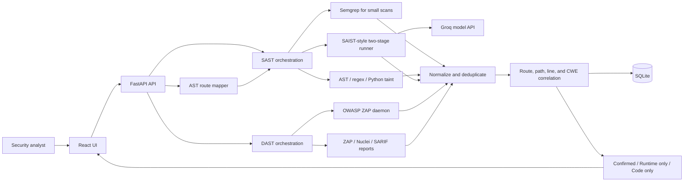
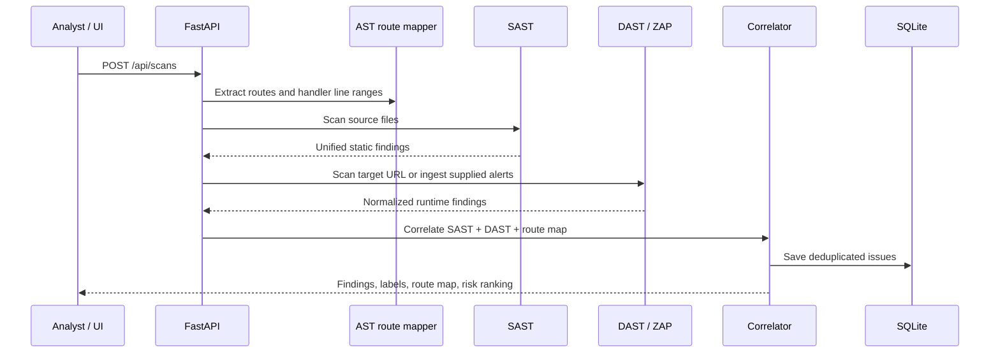

# Cyber-Forge — SAST + DAST Correlation

## 1. What it does

Cyber-Forge scans Python source and running web applications, then connects static findings to runtime evidence. It offers a FastAPI API and React interface, uses OWASP ZAP for active DAST, stores results in SQLite, and ranks correlated findings for review.

## 2. Architecture



The Docker deployment runs Cyber-Forge beside PyGoat and ZAP. Cyber-Forge shares PyGoat's network namespace so the scanner can reach the application and ZAP. The optional BenchmarkPython app and its dedicated ZAP instance run through `docker-compose.benchmark.yml`.

## 3. End-to-end flow



## 4. SAST implementation

1. The route mapper parses Python route decorators and supported framework patterns, recording HTTP method, URL, handler, and source line range.
2. Semgrep runs on smaller source folders. For folders with more than 10 Python files, the current optimization skips Semgrep to avoid remote registry latency.
3. Deterministic AST/regex rules and the Python taint engine run locally.
4. The SAIST runner analyzes Python files when enabled. Its supported focus is **CWE-89** (SQL injection), **CWE-79** (XSS), **CWE-22** (path traversal), **CWE-78** (OS command injection), **CWE-798** (hard-coded credentials), **CWE-328** (weak hashing), **CWE-918** (SSRF), and **CWE-601** (open redirect).
5. The current container does not include the official `datadog-saist` executable. It therefore uses the project's native SAIST-style detection and validation prompts through Groq (`GROQ_MODEL`). This is not Datadog's hosted model or official CLI. The current path discards missing/unsupported CWE labels, invalid source lines, and candidates that lack HIGH-confidence validation.
6. Findings from the enabled scanners are enriched with route context and deduplicated before correlation.

The precision-oriented validation may reduce false positives, but can also reduce recall. SAST findings should still be reviewed in context.

## 5. DAST implementation

- **Live scan:** Cyber-Forge calls OWASP ZAP, seeds the target and known routes, spiders the target, and collects ZAP alerts. Active scanning depends on ZAP's configured policies and the target being reachable.
- **Report ingestion:** ZAP JSON, Nuclei JSON/JSONL, and SARIF results can be normalized to the common finding format.
- **Passive fallback:** if ZAP is unavailable but the target responds, limited HTTP checks inspect security headers, cookies, server banners, and debug disclosures. This fallback does not provide active exploit coverage.
- **Normalization:** alerts retain URL path, method, parameter, payload/evidence, severity, and canonical CWE where available.

## 6. Correlation and issue labels

The correlator uses canonical CWE plus route/path and line/parameter context to join findings and remove duplicates.

| Label | Meaning |
|---|---|
| **Confirmed** | A SAST finding matches a DAST finding in the source/runtime context. |
| **Runtime only** | DAST observed a finding with no matching source finding. |
| **Code only** | SAST found a source issue without a matching runtime finding. |

These labels describe evidence correlation. They do not guarantee exploitability for every finding.

## 7. OWASP BenchmarkPython evaluation

### Setup

- Suite: OWASP BenchmarkPython v0.1, **1,230** answer-key cases.
- Run: deterministic balanced sample of **140** cases, 10 from each of 14 categories (five vulnerable and five non-vulnerable), seed `20261101`.
- DAST: target-specific replay and an 11-rule low-strength ZAP profile; no full-suite spider. Runtime was **667.34 seconds** (about 11 minutes).
- Scoring: a case counts as a hit only when the scanner finding maps to the testcase and matches its exact expected CWE.

### Exact expected-CWE score

| Scanner | TP | FP | TN | FN | Accuracy | Precision | Recall |
|---|---:|---:|---:|---:|---:|---:|---:|
| ZAP raw alerts | 13 | 0 | 70 | 57 | 59.3% | 100.0% | 18.6% |
| Cyber-Forge DAST | 13 | 0 | 70 | 57 | 59.3% | 100.0% | 18.6% |
| Cyber-Forge SAST | 70 | 0 | 70 | 0 | 100.0% | 100.0% | 100.0% |
| Combined SAST + DAST | 70 | 0 | 70 | 0 | 100.0% | 100.0% | 100.0% |

The exact-CWE SAST score is not a claim of perfect general accuracy: the broader “any finding on a testcase” SAST measure recorded 5 false-positive cases. Exact-CWE scoring excludes findings that do not match the expected label. The sample is only 140 of 1,230 cases.

### Faster and broader ZAP profiles

| Profile | Duration | Exact-CWE ZAP hits | Cyber-Forge DAST hits | Exact-CWE DAST false positives |
|---|---:|---:|---:|---:|
| Earlier 21-rule profile | ~20 min | 17 | 19 | 10 |
| Focused 11-rule profile | 11 min 7 sec | 13 | 13 | 0 |

The focused profile reduced scan time and exact-CWE false positives, with fewer exact-CWE DAST hits because it covered fewer ZAP rules. The comparison is limited to the recorded runs and their configurations.

### Measurement caveat

The 140-case benchmark results above were recorded **before** SAIST was enabled for large batch scans and before the latest precision filters. The numbers are a baseline for that earlier SAST configuration; they do not measure the current SAIST-enabled batch scanner. Re-run the benchmark before drawing conclusions about the updated SAST path. See [benchmark-results/analysis.md](benchmark-results/analysis.md) and [benchmark-results/score.json](benchmark-results/score.json) for details.

## 8. Run it

Start the main stack:

```sh
docker compose -f docker-compose.pygoat.yml up -d --build
```

Start the optional benchmark target and scanner, then run the 140-case sample:

```sh
docker compose -f docker-compose.pygoat.yml -f docker-compose.benchmark.yml up -d --build benchmark benchmark-zap cyberforge
docker compose -f docker-compose.pygoat.yml -f docker-compose.benchmark.yml --profile benchmark run --rm benchmark-runner --cases-per-category 10
```

See [README.md](README.md) for configuration, endpoints, and additional operating details.
